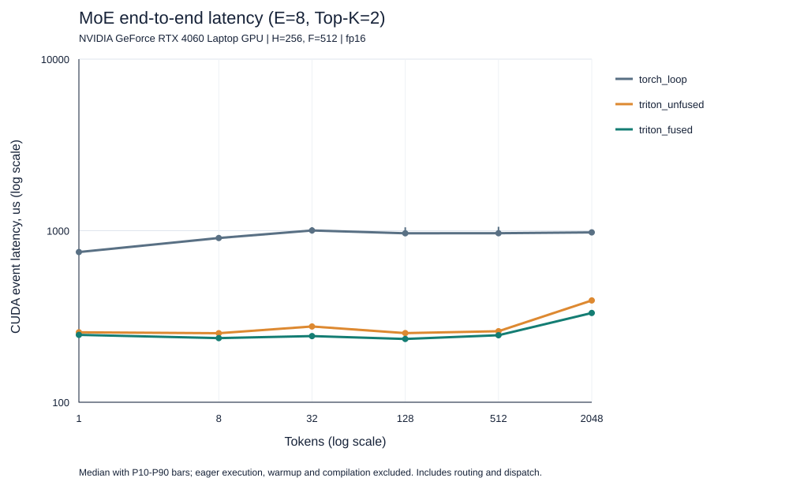

# MoE 远程实测报告

报告生成时间：2026-11-04T15:03:17+08:00（Asia/Shanghai）。

## 环境与位置

- 服务器项目：`/home/ggbond/Desktop/MoE`；系统桌面入口：`/home/ggbond/桌面/MoE`（符号链接）。
- GPU：NVIDIA GeForce RTX 4060 Laptop GPU，显存 7.75 GiB，compute capability [8, 9]，SM 数 24。
- PyTorch 2.5.1+cu121 / CUDA runtime 12.1 / Triton 3.1.0。
- Python：`/home/ggbond/miniconda3/envs/nanovllm/bin/python`。未安装、升级依赖，未修改系统或其他项目文件。
- 缓存限制在项目 `.triton-cache` 和 `.cuda-cache`，没有修改全局缓存配置。

## 正确性

- unittest 方法数 6，失败 0，错误 0，跳过 0。
- 记录 174 个 CUDA 张量比较；另有 CPU dense oracle、路由及 inverse 检查。
- torch.bfloat16：最大绝对误差 0.0078125，最大 relative L2 0.004014781。
- torch.float16：最大绝对误差 0.0009765625，最大 relative L2 0.0004991963。
- 首轮遇到 Triton 3.1 int32/int64 loop-carried variable 编译错误；修复为 int64 边界后重跑全部通过。首次失败日志及最终日志均保留。

## 实际执行命令

```bash
cd /home/ggbond/Desktop/MoE
export TRITON_CACHE_DIR="$PWD/.triton-cache"
export CUDA_CACHE_PATH="$PWD/.cuda-cache"
PY=/home/ggbond/miniconda3/envs/nanovllm/bin/python
"$PY" environment.py > results/environment.log 2>&1
"$PY" -m tests.test_moe > results/tests.log 2>&1
"$PY" benchmark.py --profile full --tune > results/benchmark.log 2>&1
"$PY" kernel_benchmark.py > results/kernel-benchmark.log 2>&1
"$PY" plot_results.py
"$PY" summarize.py
```

完整软件版本见 `results/pip-freeze.txt`，命令和退出码见 `results/commands.log`。

## 性能矩阵与计时

- 共 1144 条方法/配置测量；方法计数：`{'torch_loop': 216, 'triton_unfused': 54, 'triton_fused': 378, 'torch_cublas': 325, 'triton_grouped': 162, 'BM16_BN32': 1, 'BM16_BN64': 1, 'BM16_BN128': 1, 'BM32_BN32': 1, 'BM32_BN64': 1, 'BM32_BN128': 1, 'BM64_BN32': 1, 'BM64_BN64': 1, 'BM64_BN128': 1}`。
- 实际参数：`{"profile": "full", "tokens": null, "hidden": 256, "ffn": 512, "dtype": "fp16", "warmup": 5, "samples": 9, "repeats": 3, "tune": true, "output": "results/benchmark.json"}`。
- T={1,8,32,128,512,2048}，E={4,8,16}，K={1,2,4}。每组人工路由覆盖 uniform/random/skewed；E2E 由实际 FP32 router 产生路由。
- 每方法先校验正确性并完成编译，再预热；CUDA event 样本和同步主机 wall time 都保留。使用 eager 执行，没有 CUDA Graph。
- 端到端包括 router、dispatch、FFN 和 combine。grouped GEMM 使用预排列输入，排除路由和 dispatch；其 wrapper 仍包含输出分配及 launch。

## 端到端结果（E=8，K=2）

| Tokens | PyTorch μs | Triton 非融合 μs | Triton 融合 μs | 融合 P10–P90 μs | 加速比 | 融合 wall μs | 融合显存增量 MiB |
|---:|---:|---:|---:|---:|---:|---:|---:|
| 1 | 750.93 | 255.66 | 247.04 | 240.03–251.70 | 3.04× | 252.99 | 0.006 |
| 8 | 906.58 | 252.58 | 236.54 | 230.26–244.28 | 3.83× | 243.13 | 0.037 |
| 32 | 1003.13 | 276.48 | 243.03 | 234.19–251.07 | 4.13× | 246.80 | 0.143 |
| 128 | 965.97 | 252.93 | 233.81 | 230.81–241.39 | 4.13× | 238.13 | 0.568 |
| 512 | 967.00 | 259.41 | 245.81 | 240.98–250.33 | 3.93× | 252.51 | 2.270 |
| 2048 | 977.63 | 392.11 | 331.43 | 329.54–337.31 | 2.95× | 335.43 | 9.079 |



## 分层结果概览

下表汇总所有测到的 shape 和路由分布，范围并非同一个工作负载的统计置信区间。

| 范围 | Triton 方法 | 配置数 | 最低加速比 | 加速比中位数 | 最高加速比 |
|---|---|---:|---:|---:|---:|
| end_to_end | triton_fused | 54 | 1.66× | 3.88× | 7.91× |
| routed_moe | triton_fused | 162 | 1.77× | 3.86× | 9.46× |
| grouped_gemm | triton_grouped | 162 | 0.85× | 1.96× | 5.26× |
| gate_up_swiglu | triton_fused | 162 | 2.03× | 3.70× | 8.12× |

## Tile 实验

T=512/E=8/K=2/random 的九组 tile 中，本轮最快为 `BM32_BN64`，40.62 μs；默认 BM32/BN64 未根据本轮结果自动更改，避免对测量集过拟合。

| Tile | CUDA 中位数 μs | P10–P90 μs |
|---|---:|---:|
| BM16_BN32 | 67.55 | 66.83–71.34 |
| BM16_BN64 | 57.32 | 53.85–58.44 |
| BM16_BN128 | 49.15 | 45.94–50.59 |
| BM32_BN32 | 71.61 | 70.84–73.18 |
| BM32_BN64 | 40.62 | 37.89–41.64 |
| BM32_BN128 | 41.64 | 37.06–44.58 |
| BM64_BN32 | 44.37 | 41.99–45.72 |
| BM64_BN64 | 42.67 | 41.64–47.24 |
| BM64_BN128 | 45.74 | 44.03–47.29 |

## CUDA Graph 算子耗时

另外完成 72 条纯设备方向的 microbenchmark，每图 32 个同一 kernel 节点，15 个 replay 样本，按节点均摊。
预排列输入、GPU offsets、编译与分配均在计时外；反复访问同一权重，是 warm-cache 结果，不可直接替代端到端时延。

| E=8/K=2/random Tokens | Grouped Gate/Up μs | Grouped Gate/Up + SwiGLU μs |
|---:|---:|---:|
| 1 | 4.672 | 5.120 |
| 32 | 10.304 | 8.926 |
| 512 | 36.288 | 26.688 |
| 2048 | 135.162 | 92.608 |

## 解读与限制

- 融合投影在 54 个端到端配置中有 51 个比非融合版本更快；其余配置没有收益，详见 JSON/CSV。
- PyTorch baseline 使用逐 expert 动态 torch.where，会产生 host/device 同步和多次 launch；加速比包含减少这些开销的收益。CUDA event 区间也包含 CPU 供给不足导致的设备空闲，不等于纯计算 kernel 时长。
- 单 grouped projection 的 PyTorch/cuBLAS 对照使用预先准备的 counts，没有在计时中读取 offsets；仍包含多次 GEMM 和 torch.cat。
- 完整性能矩阵为 FP16；BF16 已做正确性验证，本轮未运行 BF16 性能矩阵。H=256/F=512 是 8GB 显存上的小型实验，不代表真实大型 MoE 模型。
- 固定 worker 数、显式 BM/BN sweep，未实现全自动最优配置搜索、专用 decode kernel、torch.compile、反向、分布式或量化；CUDA Graph 仅用于算子 microbenchmark，端到端未使用。
- 目标环境未安装 vLLM；没有 vLLM 对照、没有 nano-vLLM 集成，不能据此声明优于生产框架。
- 显存为本进程 PyTorch allocator allocated 峰值，不含驱动、Triton module 和其他进程；环境记录保留了测试前的 nvidia-smi。
- 笔记本 GPU 动态功耗、时钟、散热和桌面服务影响波动；没有锁频、独占 GPU 或使用 profiler。没有改动系统设置来控制这些因素。
- 各方法依次测量，未随机化执行顺序；预热次数有限，功耗和缓存状态仍可能影响比较。P10/P90 是本轮样本分位数，不是统计置信区间。
- 没有将选中的路由权重与 GEMM 数值实现融合；router 仍由 PyTorch 完成。Gate/Up+SwiGLU 和 combine 是两处实际融合。

## 文件

- `results/environment.json`、`results/pip-freeze.txt`：环境。
- `results/tests.log`、`results/correctness.json`：最终测试与逐项误差。
- `results/benchmark.json`、`.csv`：全部测量及原始样本；`.svg`：曲线。
- `results/commands.log`、`results/*.exit`：命令与退出码。
- 首次失败日志独立保存，最终成功状态以最终测试日志和退出码为准。
