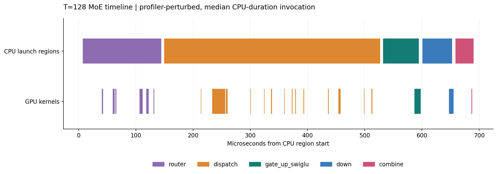

# P0：完整 MoE 路径性能分析

报告生成：2026-11-07T17:44:12+08:00，Asia/Shanghai。

## 完成范围

- RTX 4060 Laptop / PyTorch 2.5.1+cu121 / Triton 3.1.0；测试 H=256/F=512/E=8/K=2，T=1/128/2048。
- Router、Dispatch（排序、counts/offsets、gather、inverse）、Gate/Up+SwiGLU、Down、Combine 均有阶段标记。
- 完成原生 Nsight Systems 2023.2.3 CUDA/NVTX 捕获与 SQLite/CSV 统计，以及 6 份 Kineto Chrome trace。
- Nsight 用 cudaProfilerStart/Stop 限定捕获范围；JIT 编译、正确性检查、预热均在捕获外。
- CUDA Events 阶段计时、详细 profiler、无标记正常基准独立采集；阶段事件不逐步同步。

## 无分析器的完整前向延迟

以下时间使用未激活 Recorder 的完整前向，预热 10 次、15 组样本、每组 3 次。

| Tokens | PyTorch CUDA μs | Triton CUDA μs | 加速比 | Triton wall μs |
|---:|---:|---:|---:|---:|
| 1 | 813.40 | 359.78 | 2.26× | 368.66 |
| 128 | 1574.65 | 357.79 | 4.40× | 367.63 |
| 2048 | 1616.50 | 397.89 | 4.06× | 406.28 |

这组数值是本次实验副本的测量，不能与 11 月 4 日 v1 数字直接比较出优化收益；CPU 状态、标记包装及运行条件发生了变化。

## GPU kernel 归因与同步证据

通过 CPU launch 相关 ID 将 GPU kernel 映射到最内层阶段；同时处理 CUDA Runtime API 和 Driver API，后者覆盖 Triton。每份 trace 均检查所有 GPU kernel 已归因。

| Tokens | 路径 | Kernel 数/前向 | Kernel 时长和 μs/前向 | cudaStreamSynchronize 次/前向 |
|---:|---|---:|---:|---:|
| 1 | baseline | 71 | 107.30 | 8 |
| 1 | triton | 22 | 50.14 | 0 |
| 128 | baseline | 144 | 308.23 | 8 |
| 128 | triton | 23 | 80.74 | 0 |
| 2048 | baseline | 143 | 683.66 | 8 |
| 2048 | triton | 22 | 304.73 | 0 |

T=128 的优化路径阶段明细（GPU kernel 的执行时长和；来自 profiler，包含扰动）：

| 阶段 | Kernel 数/前向 | Kernel 时长和 μs/前向 |
|---|---:|---:|
| router/linear | 3 | 7.091 |
| router/topk_softmax | 3 | 10.675 |
| dispatch/sort | 3 | 26.598 |
| dispatch/counts_offsets | 7 | 8.346 |
| dispatch/gather | 2 | 5.056 |
| dispatch/inverse | 2 | 2.675 |
| triton/gate_up_swiglu | 1 | 10.963 |
| triton/down | 1 | 8.045 |
| triton/combine | 1 | 1.293 |

原生 Nsight 捕获共 30 次前向（3 个 T × 2 条路径 × 5 次）。下列统计覆盖整个捕获范围，不直接代表单个阶段：

| CUDA API | 调用数 | CPU API 时长和 μs |
|---|---:|---:|
| cudaLaunchKernel_v7000 | 2080 | 11293.30 |
| cudaMemcpyAsync_v3020 | 165 | 967.70 |
| cudaStreamSynchronize_v3020 | 120 | 566.74 |
| cuLaunchKernel | 45 | 442.87 |

图从实际 Kineto 时间戳绘制，选择 CPU region 时长中位数对应的一次调用。上行是 CPU 发起调用的阶段范围，下行是 GPU kernel；不是 Nsight GUI 截图。原生 `.nsys-rep` 另行保留，可在 Nsight Systems 中打开。

## 结论与下一步

1. T=128 的 Dispatch 使用 14 个 kernel，kernel 时长和约 42.67 μs，占该 trace 全部 kernel 时长和约 52.9%。排序是最大的单个 Dispatch 子阶段。该比例是 GPU kernel 工作量的占比，不是未分析前向延迟的占比。
2. PyTorch baseline 每次前向有 8 次 cudaStreamSynchronize，与 8 个 expert 的动态筛选路径相符；优化路径在标记前向范围内未记录到该 API。
3. 小 T 路径有大量短 kernel 与时间线间隙，支持优先研究 Dispatch、工作空间复用和完整路径 CUDA Graph。仅根据 gap 不能断言全部是 CPU launch 延迟，还可能包括复制、依赖和分析器影响。
4. T=2048 时两个 grouped projection 的 GPU 工作显著增大，计算与访存优化的重要性上升。应区分 decode 和 prefill 的优化策略。
5. 后续性能改动应使用未激活标记的前向评估，再用 timeline 解释原因。

## 测量限制与修正记录

- 首轮 record_function 同时用于事件计时，扰动明显；已将详细 CPU trace 与轻量事件计时拆开，首轮结果保留在 results/p0-first-pass。最终表格取 results/p0。
- 最初归因器只读 Runtime API，会遗漏每次 3 个 Triton Driver API launch；已修复并加入全部 kernel 归因检查。最终 T128 为 23 个 kernel，不是仅 ATen 的 20 个。
- 即使轻量 CUDA Event 标记也会增加开销，profile.json 中的阶段区间包含主机供给间隙；父子阶段重叠，不能直接相加，也不能从普通基准中逐项相减。
- kernel 时长和、GPU 活跃区间并集与端到端耗时是不同指标；本报告分别保留，不把它们混用。
- 未做 Nsight Compute 硬件计数器分析、锁频或独占 GPU；不据此宣称 SM、Tensor Core 或带宽达到峰值。

## 证据与复现

- profile_moe.py：阶段采集；analyze_traces.py：相关 ID 归因；results/p0/profile.json：独立基准与阶段事件。
- results/p0/nsys.nsys-rep、nsys.sqlite、nsys-stats.log：原生报告、数据库与统计。
- results/p0/T*.trace.json：Chrome/Perfetto 可读时间线；trace-analysis.json：逐 kernel 归因。
- 所有正式步骤退出码为 0；命令见 results/commands.log。完整重跑：bash run_all.sh。
