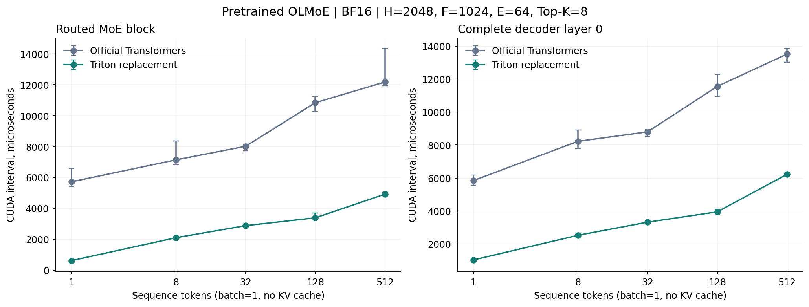

# P3：真实预训练 OLMoE 模型层接入

报告生成：2026-11-07T17:44:12+08:00，Asia/Shanghai。

## 实际接入范围

使用 allenai/OLMoE-1B-7B-0924 的真实预训练 embedding 和完整 decoder layer 0，保留原始 attention、RoPE、RMSNorm 与 residual，只替换其中的 routed MoE MLP。

固定 checkpoint revision：`6d84c48581ece794365f2b8e9cfb043c68ade9c5`。H=2048，F=1024，E=64，Top-K=8，norm_topk_prob=false。未缩小 expert 数或用随机权重冒充预训练模型。

来源：[固定版本 checkpoint](https://huggingface.co/allenai/OLMoE-1B-7B-0924/tree/6d84c48581ece794365f2b8e9cfb043c68ade9c5)。本机 Transformers 4.57.6 的官方 OlmoeDecoderLayer 与 OlmoeSparseMoeBlock 为对照；实现源码 SHA256 记录在 integration JSON。

## 权重与输入来源

- 只按 HTTP Range 下载所需 202 个预训练张量，约 996.8 MiB，不下载约 14GB 的全模型。
- 每个响应要求精确的 HTTP 206 Content-Range 与长度；重建有效的独立 safetensors 子集，保存固定版本、原始 tensor 字节区间及子集 SHA256。
- 子集哈希用于重跑完整性检查；没有下载完整 shard，因此不声称验证过完整 shard 的数据哈希。
- 自编写的公开测试文本经官方 tokenizer → 真实 embedding → 原始 attention/residual/norm，得到 MoE 输入；每例 input IDs 全部记录。
- B=1 的序列长度为 1/8/32/128/512，另测 B=2/S=16。均为无 KV cache 的因果前向；S=1 不代表完整服务的 cached decode。

## 语义适配

1. Router 使用原始低精度 Linear 输出，在 FP32 对全部 64 个 logits 做 softmax，选 Top8，不重新归一化，再转换为输入 dtype。
2. 将 gate/up/down 的 nn.Linear 权重转置并打包成 grouped GEMM 布局；打包在计时外，仅首次接入执行。
3. 投影输出、SiLU 输出、hidden product 按官方输入 dtype 舍入；同时保留 v1 默认激活语义。
4. 按 expert ID 排序被选中的 slot，combine 先将路由乘积舍入，再按 expert 递增顺序逐次低精度累加，对齐官方 expert loop。
5. 返回 `(hidden_states, router_logits)`，保持 decoder layer 调用接口；适配器为 inference-only，eval 模式。

## 正确性与性能

v1 的 6 个 unittest 方法及 174 项 CUDA 比较通过；新增适配器回归覆盖两种 dtype、归一化开关和三种输入形状，共 12 组。

真实权重比较 12 组：BF16/FP16 各 6 组，分别检查 MoE 输出、完整 decoder 输出和 router logits。所有组通过预先设置的逐元素与 relative L2 阈值，router logits 逐元素完全一致。

| Dtype | B×S | MoE relative L2 | Decoder relative L2 | 官方 MoE μs | Triton MoE μs | MoE 加速 | 官方 decoder μs | Triton decoder μs | Decoder 加速 |
|---|---|---:|---:|---:|---:|---:|---:|---:|---:|
| bf16 | 1×1 | 0.000749618 | 0.000590891 | 5715.46 | 611.33 | 9.35× | 5843.46 | 1032.70 | 5.66× |
| bf16 | 1×8 | 0.00022404 | 0.000164039 | 7137.79 | 2096.64 | 3.40× | 8222.72 | 2526.72 | 3.25× |
| bf16 | 1×32 | 4.93738e-05 | 2.85342e-05 | 8014.51 | 2876.93 | 2.79× | 8797.70 | 3322.37 | 2.65× |
| bf16 | 1×128 | 0 | 0 | 10837.39 | 3384.18 | 3.20× | 11554.22 | 3948.42 | 2.93× |
| bf16 | 1×512 | 0 | 0 | 12179.42 | 4914.08 | 2.48× | 13509.79 | 6220.16 | 2.17× |
| bf16 | 2×16 | 8.5867e-05 | 7.74327e-05 | 11148.32 | 3109.55 | 3.59× | 12093.84 | 3617.47 | 3.34× |
| fp16 | 1×1 | 0.000445961 | 0.000415001 | 5564.88 | 610.82 | 9.11× | 6508.54 | 1030.66 | 6.31× |
| fp16 | 1×8 | 0.00038343 | 0.000257384 | 7054.42 | 2078.21 | 3.39× | 8031.41 | 2507.78 | 3.20× |
| fp16 | 1×32 | 0.000415708 | 0.000273085 | 8150.53 | 2895.36 | 2.82× | 8813.06 | 3310.59 | 2.66× |
| fp16 | 1×128 | 0.000441583 | 0.000280978 | 8614.40 | 3296.26 | 2.61× | 9691.68 | 3793.92 | 2.55× |
| fp16 | 1×512 | 0.000438176 | 0.000281644 | 9794.56 | 4793.38 | 2.04× | 11279.41 | 6100.48 | 1.85× |
| fp16 | 2×16 | 0.00041139 | 0.000270848 | 8329.76 | 3049.44 | 2.73× | 9450.50 | 3550.72 | 2.66× |

## 计时解释与边界

- 每方法预热 5 次，9 组样本，每组 2 次；测 CUDA event 区间与同步后的 wall time，保留 P10/P90 和全部样本。各例方法顺序固定随机种子打乱。
- MoE 对照使用 attention/norm 生成的同一真实 hidden_states；完整 decoder 对照包含相同的 attention、norm、residual，embedding lookup 不在计时中。
- 仅替换 layer.mlp；更换 module、权重打包、加载与 JIT 编译均不计入稳定态 benchmark。缓存状态为反复执行同一层的 warm-cache 条件。
- BF16 使用原始 checkpoint dtype；FP16 对同一预训练权重做 dtype 转换，原始与替换路径使用相同转换结果。不是分别重新训练的模型。
- JSON 中保留低精度舍入造成的误差；relative L2 为 0 表示该例实际输出相同，不构成对任意输入 bitwise 相等的保证。
- 相对官方 Transformers Python expert loop 的加速包含减少动态筛选、同步和 kernel launch 的收益；不证明胜过 vLLM/CUTLASS 等成熟 MoE 算子。
- 本任务完成真实 decoder layer 集成；没有加载剩余 15 层、LM head，也没有测试完整文本生成、困惑度、任务精度或服务吞吐。
- P0 的 profile 仍使用 v1 小型形状；P3 另保留真实层 T32 BF16 trace，不能把 P0 的阶段比例直接外推到大层。
- 单卡测试，无多 GPU、训练反向、量化或手写 CUDA C++ 新增。

## 文件与复现

- moe/hf_olmoe.py：真实模型适配器；integrate_olmoe.py：严格加载、真实输入、替换验证和 benchmark。
- results/p3/integration-{bf16,fp16}.json：每例数值误差、输入 IDs、expert counts、路由概率质量和原始计时样本。
- results/p3/checkpoint-manifest.json：202 个权重来源、字节区间和哈希；weights/olmoe-layer0/layer0.safetensors 留在服务器。
- 交付 zip 不含约 1GB 权重，包含下载器、元数据与结果；本地重跑需先按固定版本下载子集。
- 完整复现：bash run_all.sh。会覆盖最终 results；先复制保留需要的旧实验。
