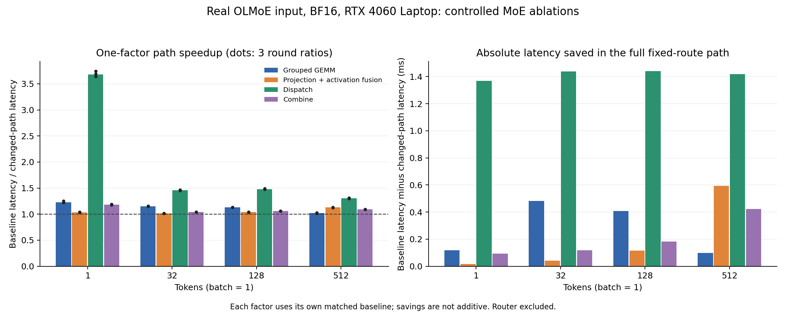

# MoE 推理优化：独立阶段基准与完整路径消融

实验执行：2026-11-15；分析整理：2026-11-16（Asia/Shanghai）。本报告不覆盖旧结果。

## 结论与范围

共完成 20 个输入用例、648 项方法计时及 52,488 次正式计时前向（不含预热和正确性检查）。全部方法通过逐元素与 relative L2 检查。计时覆盖合成小型 MoE 和真实 OLMoE 首层的 MoE 输入，不是完整 decoder layer 或全模型吞吐测试。

结果支持按输入规模分别描述收益：小型配置 grouped GEMM、融合、分发、合并均有收益；真实模型中 Gate/Up 的 grouped GEMM 单独收益较小，T=1 时比逐专家矩阵乘法略慢，Down 投影通常更受益。T=512 时 grouped GEMM 对完整固定路由路径的收益接近零，FP16 略有退化。真实模型融合在 T=32 的路径收益只有约 1%，T=512 约 13%；不能将总加速全部归因于融合或 grouped GEMM。

## 实验设计与对照

每个用例首先固定同一份路由 ids、probs，测 6 组独立阶段；然后测 2 种分发 × 4 种专家计算 × 2 种合并 = 16 条完整固定路由路径，另测原生逐专家路径。这不是 3 个互相独立二元开关的完整析因实验：投影融合嵌套在 grouped GEMM 中。所有控制路径排除 Router，分发、专家计算、合并及各自输出分配均在计时中。原生 MoE 与现有优化 MoE 的含 Router 对照单独报告。

| 维度 | Baseline | 替换后 | 控制内容 |
| --- | --- | --- | --- |
| 分发 | 逐专家 torch.where → 拼接 order → packed/offsets/inverse | 现有 pack_routes 排序打包 | 输出布局、专家顺序及元数据相同 |
| grouped GEMM | 已打包输入上逐专家 PyTorch @ + cat | 现有 grouped_mm，激活独立 | 相同输入、权重、激活 kernel；完整路径同时替换 Gate/Up 与 Down |
| 投影激活融合 | grouped GEMM → 独立 Triton SwiGLU | 现有融合 grouped GEMM | 保持相同舍入语义；Down、分发、合并不变 |
| 合并 | 按 slot 顺序的 PyTorch gather、乘法、累加 | 现有 Triton combine / _hf_combine | 相同路由权重、slot 顺序及低精度舍入 |
| 独立激活 | PyTorch SwiGLU | 独立 Triton SwiGLU | 单独控制，避免把激活重写的收益算作投影融合 |

**Baseline 边界：**逐专家 GEMM 的专家行数在计时外从 GPU 读出并缓存，不把标量回读同步算进 GEMM。这给 PyTorch 对照提供已知路由结构的优势，因此完整固定路由循环路径是受控实验，不代表动态服务中的原生实现。分发对照为了产生同样的 packed/offsets/inverse，会执行额外元数据构造；它不是原生专家循环中筛选输入的逐指令复刻。合并对照是语义对齐的 PyTorch slot 循环，不是所有可能 PyTorch 实现中最快者。原生 where+index_add 的整体表现另测，不能把本报告分发或合并倍数直接称为相对官方实现该阶段的倍数。

## 输入与测量条件

- 合成配置：H=256、F=512、E=8、Top-K=2，FP16/BF16。T=1/128/2048 使用实际随机权重 Router；T=128 另测 uniform/random/skewed 三种固定路由。随机种子 20261115。skewed 只激活前两个专家。

- 真实配置：固定 checkpoint allenai/OLMoE-1B-7B-0924，revision 6d84c48581ece794365f2b8e9cfb043c68ade9c5；H=2048、F=1024、E=64、Top-K=8，不归一化 Top-K 概率。B=1，T=1/32/128/512，FP16/BF16。三段手写文本按长度用例轮换、重复并截断；官方 tokenizer → 真实 embedding → 原始因果 attention/residual/norm → 捕获 MoE 输入。输入 token IDs、hidden states SHA256、专家计数均记录在 results.json。

- CUDA GPU：NVIDIA GeForce RTX 4060 Laptop GPU；PyTorch 2.5.1+cu121；Triton 3.1.0；Transformers 4.57.6。保留运行前与最后用例结束后的 nvidia-smi 快照。

- 每个方法先正确性检查和预热 5 次，然后分 3 轮、每轮 9 组、每组 3 次，共 27 个样本、81 次计时前向。每组打乱各方法的测量顺序，采用 CUDA Event 区间除以重复次数，主表取 27 个样本中位数；CSV 同时保留 P10/P90、同步 wall time 和每轮中位数。

- 无梯度，无 CUDA Graph，无 profiler；TF32、FP16/BF16 reduced-precision reduction 关闭。权重打包、原始 attention 输入构造、路由预计算、JIT 编译不计入固定路由路径；完整含 Router 对照包含每次路由计算。重复执行同一输入及权重，属于 warm-cache 测试。

- 未锁频、未独占 GPU；同一轮的比值范围仅是重复稳定性描述，不是统计置信区间。3 轮并非 3 次冷启动独立实验。不得用 CUDA Event 时间声称获得纯硬件 kernel 执行时间：区间可能包含主机发起不及时造成的 GPU 空闲，短算子尤其如此。

## 独立阶段结果

下面的格式为「baseline μs → 优化 μs（倍数）」；倍数 >1 表示优化更快。Gate/Up 与 Down 分别排除分发、激活和合并；融合阶段比较 grouped_unfused 与 grouped_fused。

| 输入 | Gate/Up GEMM | Down GEMM | 投影激活融合 | 分发 | 合并 |
| --- | --- | --- | --- | --- | --- |
| synthetic/float16/T1/router | 57.00 → 27.65（2.06×） | 56.61 → 26.28（2.15×） | 42.33 → 25.60（1.65×） | 250.22 → 103.77（2.41×） | 62.81 → 17.75（3.54×） |
| synthetic/float16/T128/router | 74.75 → 33.42（2.24×） | 75.73 → 26.30（2.88×） | 41.64 → 29.35（1.42×） | 274.77 → 105.81（2.60×） | 67.96 → 19.80（3.43×） |
| synthetic/float16/T128/uniform | 73.05 → 29.33（2.49×） | 76.82 → 25.60（3.00×） | 38.23 → 27.65（1.38×） | 244.46 → 96.67（2.53×） | 65.85 → 18.43（3.57×） |
| synthetic/float16/T128/random | 76.80 → 31.74（2.42×） | 77.82 → 25.94（3.00×） | 40.28 → 28.33（1.42×） | 251.85 → 102.06（2.47×） | 64.55 → 16.37（3.94×） |
| synthetic/float16/T128/skewed | 46.08 → 29.70（1.55×） | 48.47 → 25.26（1.92×） | 40.62 → 26.55（1.53×） | 244.39 → 102.06（2.39×） | 67.93 → 18.77（3.62×） |
| synthetic/float16/T2048/router | 189.10 → 162.47（1.16×） | 103.42 → 87.04（1.19×） | 175.78 → 116.74（1.51×） | 276.82 → 107.85（2.57×） | 75.78 → 19.06（3.98×） |
| synthetic/bfloat16/T1/router | 57.34 → 26.97（2.13×） | 54.95 → 26.89（2.04×） | 41.30 → 26.28（1.57×） | 241.32 → 97.02（2.49×） | 62.15 → 18.43（3.37×） |
| synthetic/bfloat16/T128/router | 74.41 → 29.70（2.51×） | 77.12 → 27.59（2.79×） | 38.91 → 29.01（1.34×） | 244.76 → 100.03（2.45×） | 65.88 → 19.04（3.46×） |
| synthetic/bfloat16/T128/uniform | 76.12 → 29.35（2.59×） | 78.17 → 25.60（3.05×） | 39.65 → 28.27（1.40×） | 259.07 → 103.40（2.51×） | 67.84 → 18.43（3.68×） |
| synthetic/bfloat16/T128/random | 80.21 → 33.09（2.42×） | 75.78 → 25.60（2.96×） | 40.54 → 30.04（1.35×） | 256.33 → 103.42（2.48×） | 67.58 → 18.44（3.66×） |
| synthetic/bfloat16/T128/skewed | 46.42 → 28.33（1.64×） | 46.42 → 23.53（1.97×） | 36.84 → 27.99（1.32×） | 250.85 → 98.99（2.53×） | 63.83 → 15.70（4.07×） |
| synthetic/bfloat16/T2048/router | 178.52 → 162.13（1.10×） | 105.13 → 87.72（1.20×） | 176.13 → 134.83（1.31×） | 253.66 → 98.65（2.57×） | 76.43 → 18.77（4.07×） |
| pretrained_layer0/float16/T1/pretrained_router | 293.89 → 304.78（0.96×） | 212.65 → 94.24（2.26×） | 308.91 → 290.47（1.06×） | 1380.35 → 103.72（13.31×） | 273.75 → 19.11（14.32×） |
| pretrained_layer0/float16/T32/pretrained_router | 2273.28 → 2038.44（1.12×） | 1278.62 → 1034.58（1.24×） | 2043.22 → 2002.94（1.02×） | 1400.52 → 109.24（12.82×） | 274.46 → 17.75（15.46×） |
| pretrained_layer0/float16/T128/pretrained_router | 2153.47 → 1966.08（1.10×） | 1195.35 → 1014.44（1.18×） | 1989.29 → 1874.26（1.06×） | 1420.30 → 113.32（12.53×） | 270.68 → 18.77（14.42×） |
| pretrained_layer0/float16/T512/pretrained_router | 3134.46 → 3172.69（0.99×） | 1727.08 → 1733.88（1.00×） | 3280.91 → 2628.58（1.25×） | 1469.72 → 201.00（7.31×） | 484.97 → 31.40（15.44×） |
| pretrained_layer0/bfloat16/T1/pretrained_router | 294.57 → 306.45（0.96×） | 223.67 → 87.72（2.55×） | 307.20 → 288.77（1.06×） | 1361.25 → 102.40（13.29×） | 255.39 → 18.72（13.64×） |
| pretrained_layer0/bfloat16/T32/pretrained_router | 2278.40 → 2039.47（1.12×） | 1278.98 → 1036.28（1.23×） | 2046.28 → 2004.99（1.02×） | 1449.89 → 107.52（13.48×） | 272.04 → 16.38（16.60×） |
| pretrained_layer0/bfloat16/T128/pretrained_router | 2163.37 → 1964.03（1.10×） | 1229.47 → 1012.74（1.21×） | 1992.04 → 1870.51（1.06×） | 1440.77 → 114.69（12.56×） | 272.32 → 17.07（15.96×） |
| pretrained_layer0/bfloat16/T512/pretrained_router | 3195.90 → 3183.96（1.00×） | 1877.67 → 1741.14（1.08×） | 3291.78 → 2638.51（1.25×） | 1530.20 → 201.05（7.61×） | 475.42 → 35.84（13.27×） |

## 对完整固定路由路径的影响

分别只替换一个环节，其余保持固定。grouped GEMM 与融合对照固定 sort 分发、Triton 合并；分发和合并对照固定 grouped_fused 专家计算。不同列的 baseline 不同，因此节省时间不能直接相加，倍数不能相乘。格式为「节省 μs / 路径加速倍数 / 3 轮比值范围」。

| 输入 | grouped GEMM | 投影激活融合 | 分发 | 合并 |
| --- | --- | --- | --- | --- |
| synthetic/float16/T1/router | 79.19 / 1.369× / 1.343–1.421 | 19.79 / 1.102× / 1.076–1.117 | 145.44 / 1.747× / 1.708–1.756 | 68.61 / 1.353× / 1.322–1.413 |
| synthetic/float16/T128/router | 128.00 / 1.593× / 1.568–1.646 | 21.22 / 1.109× / 1.074–1.109 | 154.26 / 1.793× / 1.762–1.839 | 71.71 / 1.369× / 1.322–1.398 |
| synthetic/float16/T128/uniform | 125.59 / 1.590× / 1.546–1.624 | 17.07 / 1.087× / 1.034–1.134 | 149.16 / 1.761× / 1.725–1.814 | 67.93 / 1.347× / 1.316–1.395 |
| synthetic/float16/T128/random | 125.27 / 1.581× / 1.550–1.619 | 24.21 / 1.126× / 1.116–1.130 | 161.43 / 1.843× / 1.763–1.872 | 75.46 / 1.394× / 1.374–1.422 |
| synthetic/float16/T128/skewed | 72.70 / 1.339× / 1.273–1.391 | 21.16 / 1.109× / 1.106–1.137 | 148.14 / 1.765× / 1.747–1.792 | 73.39 / 1.379× / 1.345–1.406 |
| synthetic/float16/T2048/router | 66.56 / 1.209× / 1.194–1.225 | 53.59 / 1.202× / 1.199–1.208 | 193.17 / 1.727× / 1.697–1.749 | 56.32 / 1.212× / 1.200–1.226 |
| synthetic/bfloat16/T1/router | 80.82 / 1.373× / 1.347–1.432 | 21.24 / 1.109× / 1.055–1.112 | 152.92 / 1.782× / 1.763–1.800 | 74.38 / 1.380× / 1.351–1.389 |
| synthetic/bfloat16/T128/router | 127.32 / 1.586× / 1.578–1.655 | 17.07 / 1.085× / 1.067–1.111 | 155.01 / 1.775× / 1.718–1.932 | 70.66 / 1.353× / 1.362–1.381 |
| synthetic/bfloat16/T128/uniform | 127.59 / 1.588× / 1.516–1.613 | 22.53 / 1.116× / 1.101–1.181 | 154.97 / 1.796× / 1.767–1.821 | 80.28 / 1.413× / 1.372–1.430 |
| synthetic/bfloat16/T128/random | 134.54 / 1.636× / 1.620–1.644 | 15.37 / 1.078× / 1.062–1.084 | 152.27 / 1.776× / 1.743–1.794 | 73.01 / 1.372× / 1.345–1.397 |
| synthetic/bfloat16/T128/skewed | 57.74 / 1.262× / 1.228–1.322 | 23.83 / 1.121× / 1.063–1.186 | 149.78 / 1.763× / 1.653–1.885 | 69.91 / 1.356× / 1.283–1.395 |
| synthetic/bfloat16/T2048/router | 53.25 / 1.167× / 1.159–1.170 | 37.55 / 1.133× / 1.131–1.132 | 194.85 / 1.691× / 1.668–1.701 | 56.32 / 1.200× / 1.190–1.216 |
| pretrained_layer0/float16/T1/pretrained_router | 119.05 / 1.227× / 1.224–1.241 | 16.41 / 1.032× / 1.026–1.034 | 1387.93 / 3.727× / 3.708–3.769 | 92.84 / 1.182× / 1.179–1.185 |
| pretrained_layer0/float16/T32/pretrained_router | 465.58 / 1.147× / 1.147–1.150 | 46.08 / 1.015× / 1.012–1.015 | 1428.14 / 1.458× / 1.452–1.465 | 119.05 / 1.038× / 1.035–1.040 |
| pretrained_layer0/float16/T128/pretrained_router | 359.03 / 1.115× / 1.113–1.117 | 119.86 / 1.040× / 1.038–1.042 | 1439.40 / 1.479× / 1.473–1.501 | 181.25 / 1.060× / 1.060–1.061 |
| pretrained_layer0/float16/T512/pretrained_router | -102.13 / 0.980× / 0.979–0.985 | 591.29 / 1.128× / 1.124–1.129 | 1407.41 / 1.305× / 1.301–1.305 | 415.50 / 1.090× / 1.085–1.095 |
| pretrained_layer0/bfloat16/T1/pretrained_router | 118.75 / 1.225× / 1.220–1.252 | 16.73 / 1.033× / 1.036–1.037 | 1368.06 / 3.677× / 3.643–3.745 | 92.49 / 1.181× / 1.178–1.190 |
| pretrained_layer0/bfloat16/T32/pretrained_router | 483.05 / 1.153× / 1.151–1.154 | 42.26 / 1.014× / 1.012–1.015 | 1436.67 / 1.460× / 1.451–1.467 | 117.08 / 1.037× / 1.037–1.039 |
| pretrained_layer0/bfloat16/T128/pretrained_router | 407.87 / 1.131× / 1.129–1.132 | 116.05 / 1.039× / 1.037–1.039 | 1440.70 / 1.479× / 1.478–1.491 | 183.30 / 1.061× / 1.061–1.062 |
| pretrained_layer0/bfloat16/T512/pretrained_router | 98.99 / 1.019× / 1.017–1.025 | 593.24 / 1.128× / 1.125–1.133 | 1418.92 / 1.307× / 1.296–1.311 | 423.25 / 1.092× / 1.091–1.093 |



## 组合收益与交互

contrasts.csv 为每个用例列出 29 项对照，共 580 项。grouped GEMM、融合、独立激活分别在 4 种上下文中比较；分发、合并分别在 8 种上下文中比较；另有分发与合并同时替换的对照。下面列出真实 BF16 输入的上下文敏感性，显示“某项改进的贡献”并非固定常数。

| T | 替换项 | 不同上下文的路径加速范围 | 节省时间范围 μs |
| --- | --- | --- | --- |
| 1 | grouped_gemm | 1.014–1.482× | 26.59–299.04 |
| 1 | fusion | 0.985–1.033× | -30.31–48.47 |
| 1 | dispatch | 2.417–3.677× | 1288.64–1404.53 |
| 1 | combine | 1.026–1.422× | 50.18–273.10 |
| 32 | grouped_gemm | 1.092–1.153× | 441.44–483.05 |
| 32 | fusion | 1.011–1.018× | 42.26–82.46 |
| 32 | dispatch | 1.392–1.460× | 1432.92–1504.50 |
| 32 | combine | 1.017–1.039× | 88.67–179.10 |
| 128 | grouped_gemm | 1.080–1.131× | 366.63–444.32 |
| 128 | fusion | 1.024–1.039× | 111.27–136.94 |
| 128 | dispatch | 1.387–1.479× | 1420.35–1489.12 |
| 128 | combine | 1.031–1.061× | 153.60–246.30 |
| 512 | grouped_gemm | 1.016–1.027× | 98.99–150.87 |
| 512 | fusion | 1.088–1.128× | 574.50–600.41 |
| 512 | dispatch | 1.241–1.307× | 1398.44–1474.90 |
| 512 | combine | 1.065–1.092× | 423.25–482.30 |

## 原生与现有优化实现：含 Router 的完整 MoE

合成对照为 moe_reference 对 moe_triton；真实对照为官方 OlmoeSparseMoeBlock 对 TritonOlmoeSparseMoeBlock。两者均包含各自完整路由过程，真实模型还包含优化路径为对齐累加顺序执行的 slot 专家排序。此表是总效果，不用于单独归因。

| 输入 | 原生 μs | 优化 μs | 加速 | 3 轮范围 |
| --- | --- | --- | --- | --- |
| synthetic/float16/T1/router | 704.17 | 252.58 | 2.79× | 2.76–2.88 |
| synthetic/float16/T128/router | 999.77 | 253.23 | 3.95× | 3.87–4.19 |
| synthetic/float16/T2048/router | 998.40 | 309.93 | 3.22× | 3.14–3.30 |
| synthetic/bfloat16/T1/router | 712.36 | 261.46 | 2.72× | 2.74–2.82 |
| synthetic/bfloat16/T128/router | 985.11 | 259.75 | 3.79× | 3.75–4.14 |
| synthetic/bfloat16/T2048/router | 1007.27 | 325.25 | 3.10× | 3.09–3.17 |
| pretrained_layer0/float16/T1/pretrained_router | 5205.35 | 563.20 | 9.24× | 9.15–9.32 |
| pretrained_layer0/float16/T32/pretrained_router | 8104.96 | 3186.37 | 2.54× | 2.53–2.56 |
| pretrained_layer0/float16/T128/pretrained_router | 8020.31 | 3063.13 | 2.62× | 2.62–2.63 |
| pretrained_layer0/float16/T512/pretrained_router | 9766.25 | 4665.00 | 2.09× | 2.08–2.10 |
| pretrained_layer0/bfloat16/T1/pretrained_router | 5198.51 | 565.93 | 9.19× | 9.12–9.31 |
| pretrained_layer0/bfloat16/T32/pretrained_router | 8233.30 | 3181.91 | 2.59× | 2.58–2.59 |
| pretrained_layer0/bfloat16/T128/pretrained_router | 8243.54 | 3065.86 | 2.69× | 2.66–2.73 |
| pretrained_layer0/bfloat16/T512/pretrained_router | 9965.91 | 4683.85 | 2.13× | 2.10–2.14 |

## 正确性与解读限制

- 共 648 项方法检查通过。FP16：atol=.004、rtol=.025、relative L2≤.005；BF16：atol=.035、rtol=.06、relative L2≤.03。分发的 packed、offsets、inverse 与逐专家稳定分组逐元素完全一致。真实模型固定路由参考输出另与官方模块比较。

- 完整路径 grouped GEMM 对照同时改变两次投影，因此需要结合独立 Gate/Up 和 Down 表解释。独立 grouped GEMM 对照也包含 PyTorch split/cat 及输出分配，不能声称证明 Triton 的矩阵计算内核本身优于 cuBLAS。

- 合并微基准在真实模型上大幅加速，但映射到计算较重的完整路径后收益明显缩小。分发对照包含逐专家 where 的动态输出同步及同布局元数据构造，不能将其倍数外推给其他 MoE 引擎。

- 真实 T=32 与 T=128 的文本不同，专家负载也不同，因此延迟不保证随 T 单调增加。这些真实用例仅 B=1、无 KV cache、少量手写文本，不代表完整服务 decode/prefill 或任务质量。

- 各阶段在不同缓存和主机供给状态下单独计时，阶段中位数相加不等于完整路径中位数。不计算“总收益中 grouped/fusion/dispatch 各占百分之几”这种依赖任意替换顺序的分摊。

## 文件与复现

- `ablate_moe.py`：GPU 消融入口；不改动生产 MoE 内核。

- `summarize_ablation.py`：从原始数据生成本报告与 CSV；没有重新拟合或修改计时数据。

- `results/ablation_20261115/results.json`：原始 27 样本、wall time、测量顺序、正确性、输入与环境快照。

- `measurements.csv`：648 项计时摘要；`contrasts.csv`：580 项完整路径对照。

- `plot_ablation.py`：可选 Matplotlib 绘图；`ablation-bf16.png/.svg` 为真实 BF16 输入的路径收益图。

- `results.json` SHA256：`08ee8f173a5efc7a3ecbac89bc390caafd1a63d7793b4e86f8fcfbe62fe70a40`。

```bash
MOE_PYTHON=/home/ggbond/miniconda3/envs/nanovllm/bin/python
TRITON_CACHE_DIR="$PWD/.triton-cache" CUDA_CACHE_PATH="$PWD/.cuda-cache" \
  "$MOE_PYTHON" ablate_moe.py --output results/ablation_new/results.json
"$MOE_PYTHON" summarize_ablation.py results/ablation_new/results.json
```

请为重跑选择新的输出目录，避免覆盖本次原始数据。权重和依赖沿用本项目现有环境。
